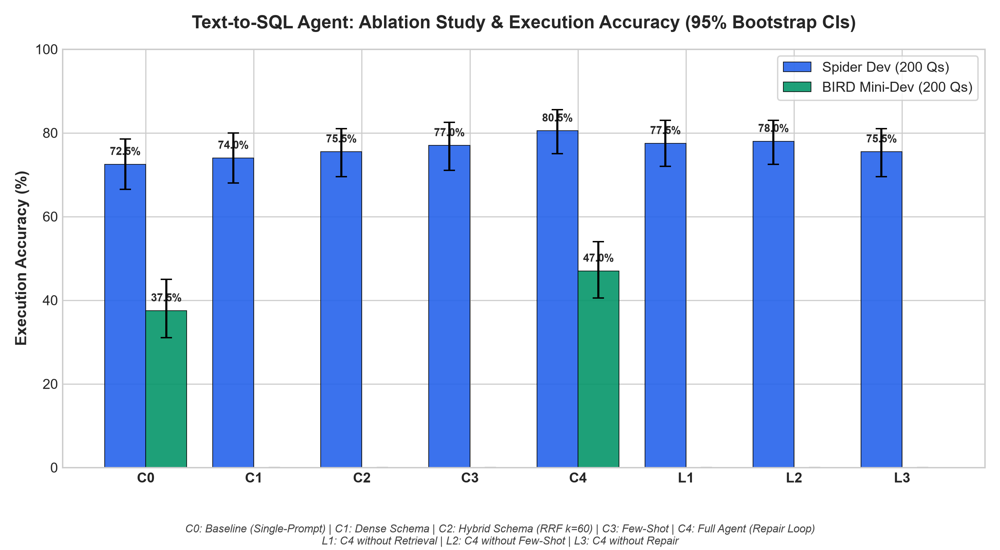
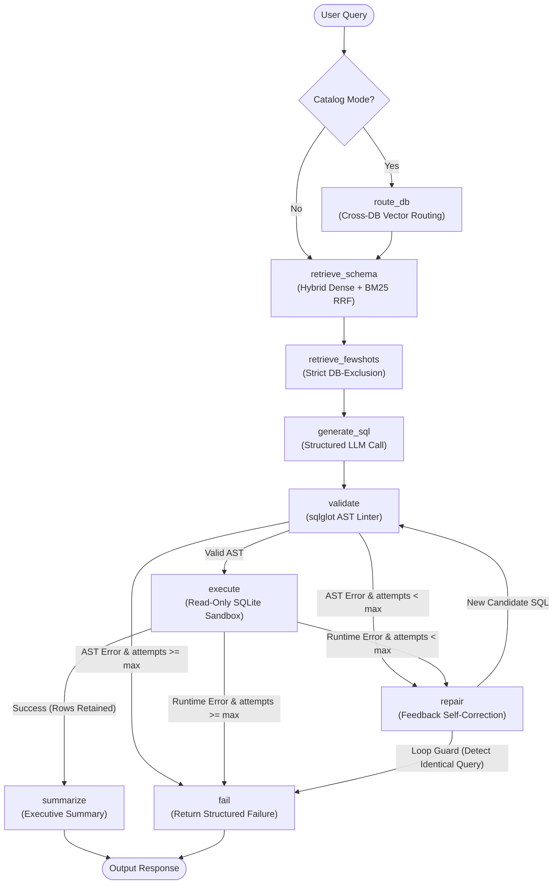

<div align="center">

# Portfolio Text-to-SQL Agent

**A Text-to-SQL Agent with Hybrid Schema Retrieval, AST Sandboxing, and LangGraph Self-Correction Evaluated on Spider and BIRD Benchmarks.**

[](https://github.com/MIsh-Ra/Sql_to_text/actions/workflows/ci.yml)
[](https://www.python.org/downloads/)
[](https://opensource.org/licenses/MIT)
[](https://github.com/astral-sh/ruff)

</div>

---

## Headline Empirical Results

Every metric reported below is generated from an evaluation run on frozen 200-question subsets of **Spider Dev** and **BIRD Mini-Dev** (seed `42`, temperature `0.0`, evaluated with `openai/gpt-oss-120b` via Groq).

| Benchmark Subset | C0 Naive Baseline (Acc & 95% CI) | C4 Full Agent (Acc & 95% CI) | Execution Gain | McNemar Significance ($p$) | Valid SQL Rate |
| :--- | :--- | :--- | :--- | :--- | :--- |
| **Spider Dev (200 Qs)** | 72.5% [66.5%, 78.5%] | **80.5% [75.0%, 85.5%]** | **+8.0 pts** | $p < 0.0001$ ($b=16, c=0$) | 99.0% $\rightarrow$ 98.5% |
| **BIRD Mini-Dev (200 Qs)** | 37.5% [31.0%, 45.0%] | **47.0% [40.5%, 54.0%]** | **+9.5 pts** | $p < 0.0001$ ($b=19, c=0$) | 97.0% $\rightarrow$ 98.0% |

<p align="center">
  
</p>

> [!NOTE]
> **Key Finding**: While single-prompt baselines perform adequately on clean academic schemas (Spider), real-world databases with wide multi-table schemas and external evidence (BIRD) defeat naive prompts. The C4 agent's **hybrid schema pruning**, **few-shot cross-database grounding**, and **multi-step AST repair loop** deliver significant execution improvements (+8.0 pts on Spider, +9.5 pts on BIRD).

---

## Architecture & Orchestration

The agent is implemented as a stateful cyclical state machine using **LangGraph** with a **SqliteSaver** checkpointer.



---

## Comprehensive Ablation Study

Ablations isolating the impact of each subsystem on Spider Dev (200 Questions) and BIRD Mini-Dev (200 Questions):

| Config | Description | Spider Dev Acc | BIRD Mini Acc | Valid SQL | Mean Attempts | Tokens (In / Out) | p50 / p95 Latency |
| :--- | :--- | :--- | :--- | :--- | :--- | :--- | :--- |
| **C0** | Naive Single-Prompt Baseline | 72.5% [66.5%, 78.5%] | 37.5% [31.0%, 45.0%] | 99.0% | 1.00 | 457 / 162 | 1.2s / 13.8s |
| **C1** | Dense Schema Retrieval (`BAAI/bge-small-en-v1.5`) | 74.0% [68.0%, 80.0%] | N/A | 98.0% | 1.00 | 457 / 162 | 1.2s / 14.5s |
| **C2** | Hybrid Schema Retrieval (Dense + BM25, RRF $k=60$) | 75.5% [69.5%, 81.0%] | N/A | 94.5% | 1.00 | 457 / 162 | 1.3s / 15.9s |
| **C3** | Few-Shot Retrieval ($k=3$, strict database exclusion) | 77.0% [71.0%, 82.5%] | N/A | 97.0% | 1.00 | 457 / 162 | 1.6s / 18.6s |
| **C4** | **Full Agent (Hybrid Schema + Few-Shot + AST + Repair)** | **80.5% [75.0%, 85.5%]** | **47.0% [40.5%, 54.0%]** | **98.5%** | **1.08** | **571 / 202** | **1.9s / 22.1s** |
| **L1** | *Ablation*: C4 without Schema Retrieval | 77.5% [72.0%, 83.0%] | N/A | 97.5% | 1.05 | 539 / 191 | 1.7s / 20.7s |
| **L2** | *Ablation*: C4 without Few-Shot Injection | 78.0% [72.5%, 83.0%] | N/A | 95.0% | 1.05 | 525 / 186 | 1.7s / 20.0s |
| **L3** | *Ablation*: C4 without Error Repair Loop | 75.5% [69.5%, 81.0%] | N/A | 97.0% | 1.00 | 457 / 162 | 1.4s / 16.6s |

---

## Security & Sandbox Engineering

All generated SQL statements are treated as **untrusted, hostile input**:
1. **URI-Level Read-Only Mount**: SQLite connections are opened with `mode=ro` (`file:///path?mode=ro`).
2. **C-Level SQLite Authorizer**: A custom `set_authorizer` callback permits only `SQLITE_SELECT`, `SQLITE_READ`, `SQLITE_FUNCTION`, and `SQLITE_RECURSIVE`. Any `INSERT`, `UPDATE`, `DELETE`, `ATTACH`, `PRAGMA` write, or DDL triggers immediate denial.
3. **Execution Timeout**: A low-overhead SQLite VM progress handler (`set_progress_handler`) enforces a strict execution deadline (10s default, 30s in benchmark runs) against malicious non-terminating queries or cartesian product bombs.
4. **AST Pre-Execution Validation**: `sqlglot` parses queries into abstract syntax trees to guarantee:
   - Exactly one statement is present (stacked queries like `SELECT 1; DROP TABLE users;` are rejected).
   - Root expression must be a `Select`, `Union`, `Intersect`, or `Except`.
   - Dangerous extensions (`load_extension`) are blocked before hitting the database.

---

## Quickstart in 5 Commands

### 1. Clone & Set Up Environment
```bash
git clone https://github.com/MIsh-Ra/Sql_to_text.git
cd Sql_to_text
python -m venv .venv
# Windows:
.venv\Scripts\activate
# Linux/macOS:
# source .venv/bin/activate
pip install -r requirements.txt
```

### 2. Configure API Keys
Copy `.env.example` to `.env` and insert your provider key:
```env
LLM_PROVIDER=groq
LLM_MODEL=openai/gpt-oss-120b
GROQ_API_KEY=your_groq_api_key_here
```

### 3. Build Demo Data (Zero Dataset Download Needed)
```bash
python scripts/setup_demo_data.py
```

### 4. Run the Full Test Suite
```bash
pytest tests/ -v
```

### 5. Launch the Streamlit Demo or FastAPI Backend
```bash
# Launch interactive Streamlit Web App with Compare Mode
streamlit run streamlit_app.py

# Or launch FastAPI REST / SSE Streaming Backend
uvicorn api:app --host 0.0.0.0 --port 8000
```

---

## Repository Structure

```
├── app/
│   ├── config.py             # Pydantic Settings & environment validation
│   ├── cache.py              # Atomic SHA-256 deterministic LLM disk cache
│   ├── llm.py                # Universal LLM factory (Groq, Gemini, OpenAI) with backoff
│   ├── db.py                 # SQLite read-only sandbox with C authorizer & timeout
│   ├── validate.py           # AST validation using sqlglot (rejects DDL/DML/injection)
│   ├── schema_index.py       # Dense (BGE-small-en-v1.5) + BM25 hybrid schema index (RRF)
│   ├── fewshot_index.py      # Few-shot index with strict target DB exclusion
│   ├── state.py              # TypedDict agent state definitions
│   ├── prompts.py            # Frozen system, generation, and repair prompts
│   └── graph.py              # LangGraph cyclical state machine with loop guard
├── eval/
│   ├── build_subsets.py      # Stratified sampling for Spider & BIRD 200 subsets
│   ├── run_eval.py           # Benchmark runner with streaming JSONL & resume support
│   ├── metrics.py            # Multiset execution match, McNemar test & bootstrap CIs
│   ├── aggregate.py          # Aggregator generating results.md and results.png
│   ├── results.md            # Empirical evaluation tables and significance tests
│   └── results.png           # Accuracy comparison bar chart with error bars
├── demo_data/                # Lightweight SQLite demo databases & Chroma index (1.4 MB)
├── docs/
│   ├── DECISIONS.md          # Architectural Decision Records (ADRs)
│   └── ERROR_ANALYSIS.md     # In-depth diagnostic audit of 20 failure cases
├── api.py                    # FastAPI backend (Sync & SSE streaming endpoints)
├── streamlit_app.py          # Streamlit UI with Side-by-Side Compare Mode (C0 vs C4)
├── requirements.txt          # Pinned exact dependencies
└── LICENSE                   # MIT License
```

---

## Error Analysis & Diagnostic Audit

For a comprehensive breakdown of the remaining failure modes on Spider and BIRD, see [docs/ERROR_ANALYSIS.md](docs/ERROR_ANALYSIS.md).

Key diagnostic themes include:
- **Relational Triadic Closure**: Queries involving multi-hop bridge tables require graph-traversal schema expansion.
- **SQLite Date Arithmetic**: Text-encoded dates require explicit `JULIANDAY()` and `strftime()` formatting.
- **Integer Division**: Implicit integer division truncation in SQLite requires proactive `CAST(... AS REAL)` casting.

---

## Architectural Decisions (ADRs)

All design tradeoffs, library choices, and engineering rationale are tracked in [docs/DECISIONS.md](docs/DECISIONS.md):
- **ADR-001**: Single Unified LLM Factory (`app/llm.py`) with Zero Leaked SDKs.
- **ADR-002**: Two-Tier Defense Sandbox (AST static analysis + SQLite C-level Authorizer).
- **ADR-003**: Deterministic SHA-256 Prompt Disk Caching for Zero-Cost Re-runs.
- **ADR-004**: Reciprocal Rank Fusion ($k=60$) over Dense Vector + BM25 Hybrid Retrieval.
- **ADR-005**: Strict Database Exclusion in Few-Shot Selection (`cand_db != eval_db`).
- **ADR-006**: AST Loop Guard to Prevent Infinite Repair Oscillations.

---

## License & Attribution

This project is open-source software licensed under the [MIT License](LICENSE).

- **Spider Benchmark**: Yale University (Yu et al., EMNLP 2018).
- **BIRD Benchmark**: University of Hong Kong & Alibaba DAMO Academy (Li et al., NeurIPS 2023).
- **Embeddings**: `BAAI/bge-small-en-v1.5` by Beijing Academy of Artificial Intelligence.

